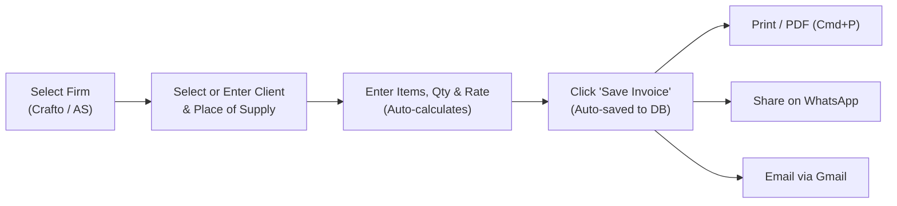

# Central Invoicing System
### GST Record Keeping & Billing

This system provides a centralized, professional invoicing dashboard and database. It automates GST calculations, record-keeping, WhatsApp sharing, Gmail billing notifications, Google Sheets synchronization, and unlimited multi-firm management.

---

## 1. System Overview & Multi-Firm Architecture

```
┌────────────────────────────────────────────────────────────────────────┐
│             CENTRAL INVOICING SYSTEM | GST RECORD KEEPING              │
├───────────────────────────────────┬────────────────────────────────────┤
│         CRAFTOGRAPHERS            │           AS ENTERPRISES           │
│  • Theme: Terracotta / Bronze     │  • Theme: Royal Navy / Sapphire    │
│  • Large Brand Logo (110px)       │  • Large Monogram Logo (110px)     │
│  • Bill Prefix: CRF-              │  • Bill Prefix: ASE-               │
│  • GSTIN: 08GFFPS1076L1ZV         │  • GSTIN: 08TFCPS8191N1Z3          │
│  • HDFC A/C: 50200050618222       │  • HDFC A/C: 50200106872092        │
├───────────────────────────────────┴────────────────────────────────────┤
│                    ➕ UNLIMITED NEW FIRMS SUPPORT                      │
│  • Register new firms anytime via the "+ Add New Firm" module          │
│  • Custom GSTIN, Bank accounts, Prefixes, and Brand Theme Colors       │
└────────────────────────────────────────────────────────────────────────┘
```

### Firm Details

| Attribute | Craftographers | AS Enterprises |
| :--- | :--- | :--- |
| **Trade Name** | Craftographers | A S ENTERPRISES |
| **Address** | 66A/67A Adinath Nager, Pal Road, Jodhpur- 342008 | 66A/67A Adinath Nager, Pal Road, Jodhpur- 342008 |
| **State & Code** | Rajasthan (`08`) | Rajasthan (`08`) |
| **GSTIN** | `08GFFPS1076L1ZV` | `08TFCPS8191N1Z3` |
| **Bank Name** | HDFC Bank | HDFC Bank |
| **Account Name**| Craftographers | AS Enterprises |
| **Account No**  | `50200050618222` | `50200106872092` |
| **IFSC Code**   | `HDFC0000142` | `HDFC0000142` |
| **Registered Email** | `info.craftographers@gmail.com` | `gem.asenterprises94@gmail.com` |

---

## 2. Core Capabilities

### A. GST Bifurcation Engine (Rule 46 Compliant)
- **Auto-Prefixed Invoice Numbering:**
  - Craftographers: Prefixed with `CRF-` (e.g. `CRF-12`, `CRF-13`), customizable per firm.
  - AS Enterprises: Prefixed with `ASE-` (e.g. `ASE-21`, `ASE-22`), customizable per firm.
- **Automatic PDF Download Naming:**
  - Every invoice downloaded or printed to PDF is automatically named according to the firm and bill number (e.g. `Craftographers_Invoice_CRF-12.pdf` or `A_S_ENTERPRISES_Invoice_ASE-21.pdf`).
- **Cleaned Invoice Header:**
  - Removed "Reverse Charge: No" and "Place of Supply" from the invoice sheet per your preference.
- **Tax Bifurcation Mode:**
  - **Intra-State:** Splits evenly into **CGST (9%) + SGST (9%)**.
  - **Inter-State:** Single toggle to apply **IGST (18%)**.
- **Automatic Round-Off:** Computes (+/-) difference to round grand totals to the nearest integer Rupee.
- **Indian Numbering Currency to Words:** Automatically renders words in Indian English (*"One Crore Six Lakh Thirty-Eight Thousand Six Hundred Rupees Only"* or *"Seven Lakh Ninety Nine Thousand One Hundred Thirty Six Rupees Only"*).

### B. Full Firm Details Configuration (GST, Address, Gmail, Bank)
- In the **Firm Profiles & Settings** tab, you and your staff can update:
  - Firm Display Name
  - Complete Registered Address
  - GSTIN
  - Gmail / Email
  - Phone / WhatsApp
  - Bill Number Prefix (e.g. `CRF-` / `ASE-` or custom format like `CRFT/2026/`)
  - Next Bill Counter Number
  - Bank Name, Account Holder Name, Account Number, and IFSC Code
- Instant saving to database with real-time updates across the dashboard.

### B. 1-Click WhatsApp Sharing
- Generates a pre-formatted, professional billing message:
  ```text
  *TAX INVOICE - CRAFTOGRAPHERS*

  Dear [Client Name],
  Please find the invoice details below:

  📄 Invoice No: [No]
  📅 Date: [Date]
  💰 Total Amount: ₹[Amount]

  🏦 Payment / Bank Details:
  • Bank: HDFC Bank
  • A/C Name: Craftographers
  • A/C No: 50200050618222
  • IFSC Code: HDFC0000142

  Thank you for your business!
  ```
- Opens `https://wa.me/[Phone]?text=[Message]` directly on WhatsApp Web or mobile with zero typing required.

### C. Gmail Integration (`info.craftographers@gmail.com`)
- 1-click **Email via Gmail** button opens Gmail Web Compose pre-addressed to the client, cc'd to `info.craftographers@gmail.com`, with subject line: `Tax Invoice #[No] from [Firm Name]` and a complete breakdown of taxable value, taxes, and bank remittance instructions.

### D. Central Record Keeping & Google Sheets Sync
- **SQLite Database (`invoicing.db`):** Every invoice is stored locally with full item breakdowns, timestamps, and payment statuses.
- **Instant CSV Export:** Download all billing history anytime in a clean format directly importable into Google Sheets.
- **Real-Time Automated Webhook:** You can paste the provided Google Apps Script in your Google Sheet to have invoices automatically append a new row whenever staff hits **Save Invoice**.

---

## 3. How to Launch & Use the System

The application is deployed at:
[http://localhost:8080](http://localhost:8080)

### Starting the Server
From the project folder at [`/Users/abhisheksharma/.gemini/antigravity/scratch/central-invoicing-system`](file:///Users/abhisheksharma/.gemini/antigravity/scratch/central-invoicing-system):
```bash
./start.sh
```
Or directly:
```bash
python3 server.py 8080
```

### Staff Workflow Steps



1. **Select Billing Firm:** Toggle between **Craftographers** and **AS Enterprises** at the top. The theme, logo, bank details, and next invoice number switch automatically.
2. **Enter Client Details:** Select a saved client from the dropdown or type a new one. (New clients are saved to the directory automatically).
3. **Add Items:** Fill in Description, HSN/SAC, Quantity, and Unit Price. The row total, subtotal, GST amounts, round-off, and grand total in words calculate in real time.
4. **Save Invoice:** Click **Save Invoice Record** (in the firm's brand color).
5. **Dispatch:**
   - Click **Print / Save PDF** to open the preview and hit `Cmd + P`.
   - Click **Share on WhatsApp** to send instant payment details to the client's mobile.
   - Click **Email via Gmail** to send an email with `info.craftographers@gmail.com` on CC.

---

## 4. Google Sheets Webhook Setup (Optional Auto-Sync)

To have every saved invoice automatically appear in your Google Sheet in real time:

1. Open your Google Sheet in Chrome.
2. Click **Extensions ➔ Apps Script**.
3. Replace the code with this snippet:
   ```javascript
   function doPost(e) {
     var sheet = SpreadsheetApp.getActiveSpreadsheet().getActiveSheet();
     var data = JSON.parse(e.postData.contents);
     sheet.appendRow([
       new Date(), data.firm_id, data.invoice_no, data.invoice_date,
       data.client_name, data.client_gstin, data.sub_total_price,
       data.cgst_amount, data.sgst_amount, data.igst_amount,
       data.round_off, data.grand_total, data.status
     ]);
     return ContentService.createTextOutput(JSON.stringify({"result": "success"})).setMimeType(ContentService.MimeType.JSON);
   }
   ```
4. Click **Deploy ➔ New Deployment**, choose type **Web App**, set *Who has access* to **Anyone**, and click **Deploy**.
5. Copy the generated Web App URL and paste it into the **Sync & Settings** tab in the dashboard.
